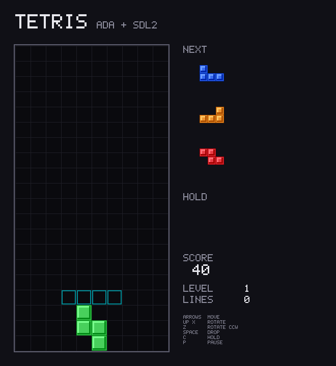

# Tetris in Ada with SDL2

Project: `tetris-ada-DSV4.1-Flash`.



Full Tetris implementation in Ada 2022 on top of
[SDLAda](https://github.com/ada-game-framework/sdlada), the SDL2 binding from the Ada game
framework.

## Requirements

- GNAT (on Arch/Manjaro: `sudo pacman -S gcc-ada`)
- gprbuild (from AUR: `yay -S gprbuild`; `gprbuild-bootstrap` is enough)
- SDL2 runtime and development files (`sdl2`)
- `git` (the Makefile clones SDLAda next to this directory on first build)

## Build and run

```sh
make          # gprbuild -P tetris.gpr, clones ../sdlada on first build
./tetris
```

Direct GPR build, once SDLAda is present:

```sh
gprbuild -P tetris.gpr
```

## Controls

| Key | Action |
| --- | --- |
| Left / Right | Move (with DAS auto-repeat) |
| Up or X | Rotate clockwise |
| Z | Rotate counter-clockwise |
| Down | Soft drop |
| Space | Hard drop |
| C | Hold / swap piece |
| P or Escape | Pause |
| R | Restart |
| Q | Quit |

## Rules implemented

- 7-bag randomizer, 5-piece preview, hold with one use per piece
- SRS rotation with the full JLSTZ and I wall-kick tables
- Ghost piece, 500 ms lock delay with 15 move resets
- Line clears scored 100/300/500/800 times the level, soft drop 1/cell,
  hard drop 2/cell, level every 10 lines with accelerating gravity
- Game over overlay when the spawn position is blocked

## Layout

- `src/tetris_game.ads/.adb` - pure game logic and SRS; no SDL dependency
- `src/tetris_render.ads/.adb` - board, HUD and overlays
- `src/tetris_font.ads/.adb` - 5x7 bitmap font, no font files needed
- `src/tetris.adb` - SDL window, event loop, timing, input
- `tests/logic_test.adb` - headless checks for rotation, hold, ghost, line clears

```sh
make test
```
